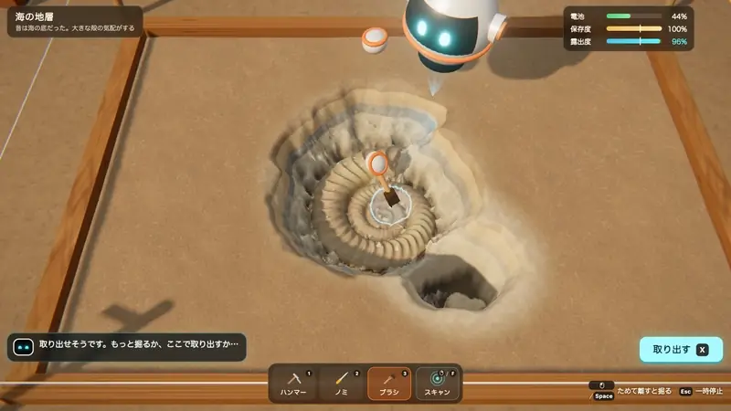
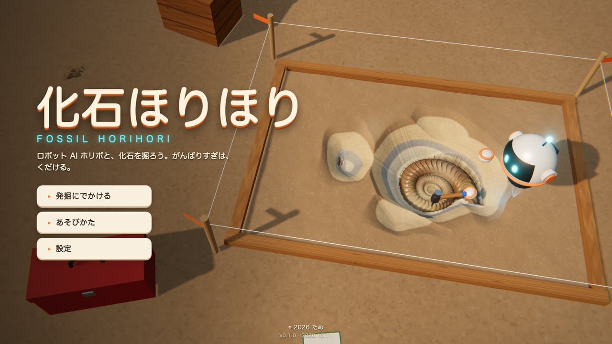
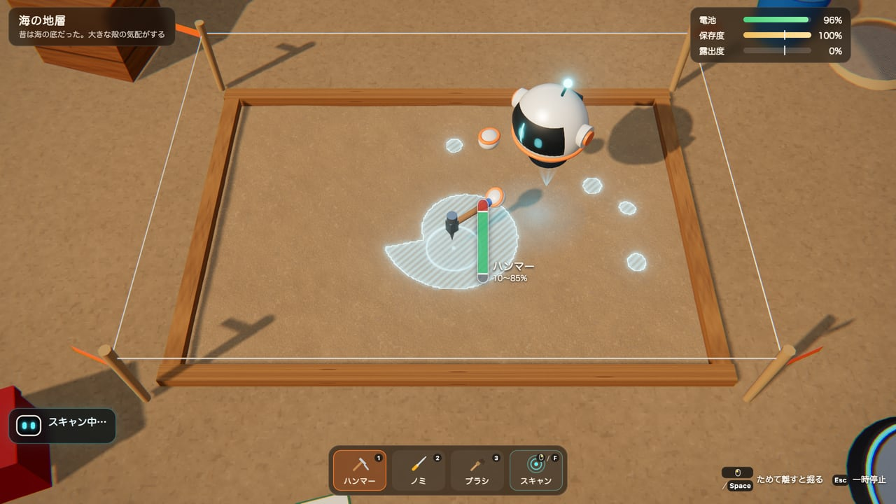
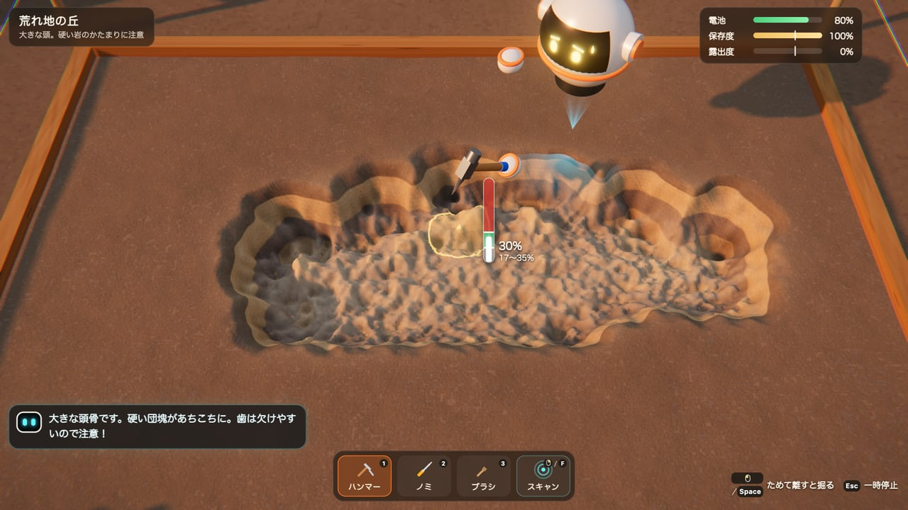
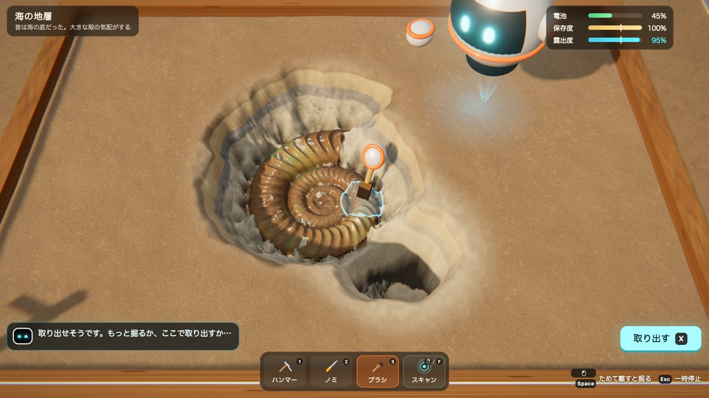
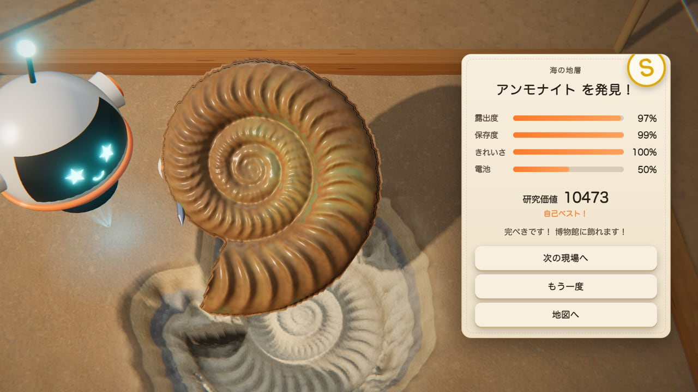
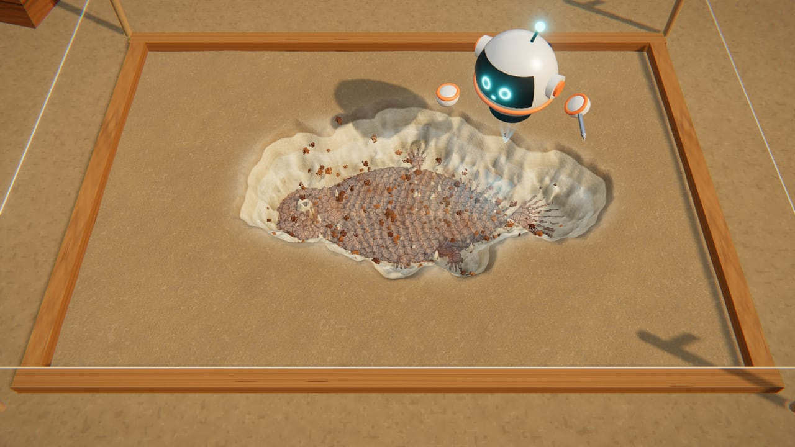
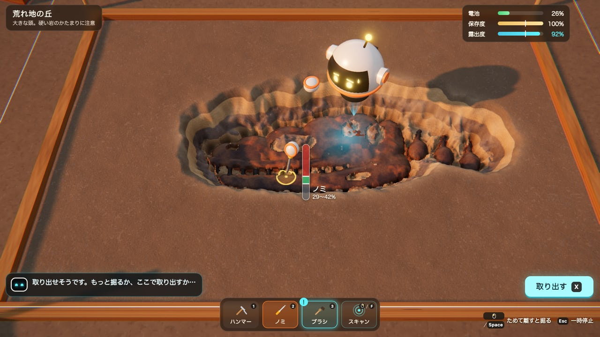
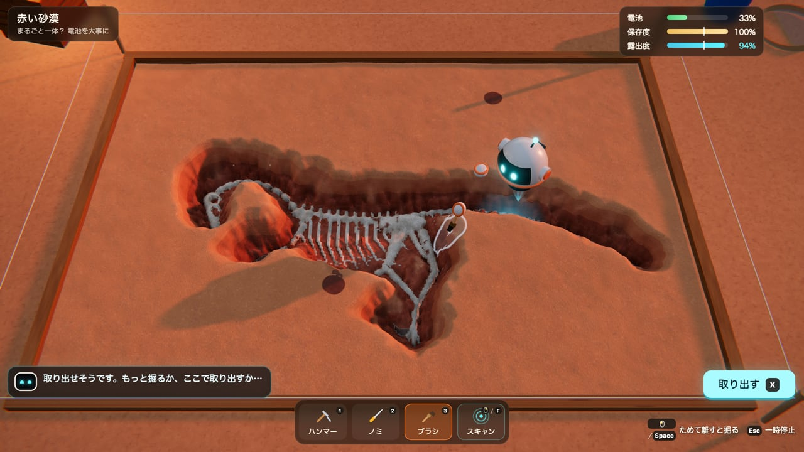

# 化石ほりほり — Fossil Horihori

ロボット AI「ホリボ」と化石を掘り出す、ブラウザで遊べる 3D 発掘ゲーム。がんばりすぎると、化石は砕ける。

[](https://tanuu5.github.io/fossil-horihori/)
[](https://www.anthropic.com/claude)
[](./LICENSE)
[](#english)

<p align="center">
  
</p>

<p align="center"><b><a href="https://tanuu5.github.io/fossil-horihori/">▶ ブラウザで今すぐ遊ぶ</a></b>（インストール不要・マウス／キーボード・ゲームパッド・タッチ対応）</p>

**Claude Code × Claude Opus 5.5（XHIGH）** で作りました。

ボタンを押しているあいだ力がたまり、離すと打つ。弱すぎると削れず、強すぎると化石にヒビが入って欠けてしまう――ホリボの解析ゲージが示す「ちょうどいい力」の緑の範囲で、ハンマー・ノミ・ブラシを使い分けて化石を掘り出します。
アンモナイトからラプトルの全身骨格まで、時間帯も地層も違う 5 つの発掘現場。取り出した化石は持ち上がり、地層には型が残ります。
地層・化石・ロボット・効果音・曲まで、画像や音声のファイルを使わず、すべてコードで作っています。
日本語と英語に対応しています（設定の「言語」で切り替え）。English follows below.

## スクリーンショット

<table>
  <tr>
    <td width="50%"><br><sub>主人公は浮遊ロボットのホリボ。LED の目で表情が変わります。</sub></td>
    <td width="50%"><br><sub>まずはスキャン。地中の化石の影がホログラムで浮かび上がる。</sub></td>
  </tr>
  <tr>
    <td><br><sub>押してためて、離すと打つ。ゲージの緑の範囲が「ちょうどいい力」。</sub></td>
    <td><br><sub>化石の近くはブラシでそっと。アンモナイトの殻が見る角度で色を変える。</sub></td>
  </tr>
  <tr>
    <td><br><sub>取り出すと化石が持ち上がり、地層に型が残る。露出度・保存度・きれいさで評価。</sub></td>
    <td><br><sub>がんばりすぎると……化石は粉々に。保存度が下がりすぎると失敗です。</sub></td>
  </tr>
  <tr>
    <td><br><sub>夕方の荒れ地ではティラノサウルスの頭骨。さび色の固い皮と欠けやすい歯に注意。</sub></td>
    <td><br><sub>最後は赤い砂漠で、ラプトルの全身骨格をまるごと掘り出す。</sub></td>
  </tr>
</table>

画像と動画は、すべて実際の画面です。

## 遊び方

1. **スキャン**で化石の場所を見る。
2. **ハンマー**で厚い土を掘る。化石に近づくほど、ゲージの緑の範囲はせまくなります。
3. 化石が見えてきたら**ブラシ**で払う。さび色の固い皮や硬い岩は**ノミ**で、弱めに少しずつ。
4. 露出度が 60% を超えたら**取り出す**。もっと掘って評価を上げるか、ここで取り出すかはあなた次第。

- 電池がなくなる前に取り出せなければ失敗。弱すぎる打撃は電池のむだ、強すぎる打撃は化石を傷つけます。
- 最大までためて押し続けると、ホリボががんばりすぎて全力で打ってしまいます。
- ブラシは化石のすぐ近くの土とホコリだけを払えます。きれいになった骨をこすり続けると、すり減って傷がつきます。

| 操作 | マウス・キーボード | ゲームパッド | タッチ |
| --- | --- | --- | --- |
| ねらう | マウス／`W` `A` `S` `D` | 左スティック | なぞる・タップ |
| ためて離すと打つ（ブラシは押しているあいだ払う） | 左クリック／`Space` | A・RT | 「ほる」ボタン |
| 道具を切りかえる | `1` `2` `3`／`Q` `E` | LB・RB | 下の道具バー |
| スキャン | 右クリック／`F` | Y | 道具バーのスキャン |
| 取り出す | `X` | X | 「取り出す」ボタン |
| ズーム | ホイール／`Z` `C` | 右スティック | 2 本指でつまむ |
| 一時停止 | `Esc` | Start | 右上の Ⅱ |

**難易度**（設定、または発掘地図で切り替え。失敗したときにも案内が出ます）

- **かんたん**：ブラシでどこでも掘れて、道具を使っていないあいだ電池が充電されます。化石も少しじょうぶ。
- **ふつう**：上のルールのとおり。
- **むずかしい**：電池が少なめで、化石がもろく、こすりすぎにも厳しい。

## 制作について

企画・ディレクション：**たぬ**　／　開発：**Claude Code（Claude Opus 5.5・推論レベル XHIGH）**

ゲームの設計から、地層と化石の高さ場・シェーダー、ロボット、効果音と曲、画面まで、Claude Code が作りました。
見た目は実 GPU のヘッドレス Chrome で撮って確かめながら直し、遊びやすさは自動で掘るボットで 5 つの現場と 3 つの難易度を試して、電池の量や道具の強さを調整しました。
ブラシの制約、難易度、ヒントの出し方などは、たぬが遊んだ感想をもとに決めています。

## 更新履歴

- **2026-10-11**：公開（v1.0.0）

## 開発

```bash
npm install
npm run dev      # 開発サーバー（http://127.0.0.1:5181/）
npm run build    # dist/ に公開用のファイル
```

- URL パラメータ：`?quality=high|medium|low`（画質を固定）、`?lang=en|ja`（言語）、`?mute`（音を出さない）、`?debug`（版表記に時刻とコミットを出す）。
- 開発サーバーでは `window.__dev` から、コマ送り・状態の確認・撮影ができます（例：`__dev.goto('play', { stage: 'trex' })`）。
- `dev/audio.html`：効果音と曲の試聴と、書き出しての確認。

| 場所 | 中身 |
| --- | --- |
| `src/game/Slab.js` | 地層のブロック：高さ場、硬さ、打撃と衝撃のシミュレーション、ブラシ、シェーダー |
| `src/game/fossils.js` | 5 つの化石の形（カプセル・楕円・渦巻きを組み合わせた手続き的なレリーフ） |
| `src/game/stages.js` | 発掘現場：地層の色と硬さ、もろさ、電池、光 |
| `src/game/Game.js` | 状態の流れ、力加減と道具、カメラ、難易度、結果 |
| `src/game/Robot.js` | ホリボ（LED の顔は canvas で描く） |
| `src/game/FossilMesh.js` | 取り出した化石の立体 |
| `src/audio/` | Web Audio で合成する効果音と曲 |

## GitHub Pages で公開する

`main` に push すると、GitHub Actions（`.github/workflows/deploy.yml`）がビルドして GitHub Pages に公開します。初回だけ、リポジトリの Settings → Pages → Source を「GitHub Actions」にします。

## クレジット・ライセンス

- コード：MIT License（[LICENSE](LICENSE)）© 2026 たぬ
- 3D 描画：[three.js](https://threejs.org/)（MIT License）
- 画像・音声のファイルは使っていません。地層・化石・ロボット・効果音・曲はすべてコードで生成しています。フォントは端末に入っているものを使います。
- MIT License の対象はこのリポジトリのコードと文章です。「Claude」の名前や商標の使用を許諾するものではありません。

---

## English

**▶ Play in your browser: https://tanuu5.github.io/fossil-horihori/**

A 3D fossil-digging game for the browser, starring Horibo the robot AI — made with **Claude Code × Claude Opus 5.5 (XHIGH)**. Try too hard, and the fossil shatters. Switch to English from **Settings → Language** (or open the page with `?lang=en`).

- Hold to charge, release to strike. Too weak does nothing; too strong cracks the fossil. Aim for the green band on Horibo's gauge.
- Hammer for thick soil, chisel for hard spots, brush for the last few centimeters — but don't over-scrub clean bone.
- Five dig sites, from an ammonite to a whole raptor skeleton, each with its own light and strata. Extracted fossils lift out and leave their mold behind.
- Three difficulty levels; Easy lets the brush dig anywhere and recharges the battery while you rest.
- Everything — strata, fossils, robot, sound effects and music — is generated in code. No image or audio files.

Controls: mouse or `WASD` aim · left click / `Space` hold and release · `1` `2` `3` / `Q` `E` tools · right click / `F` scan · `X` extract · `Esc` pause. Gamepads and touch work too.

Code is released under the MIT License. Built with three.js (MIT).
